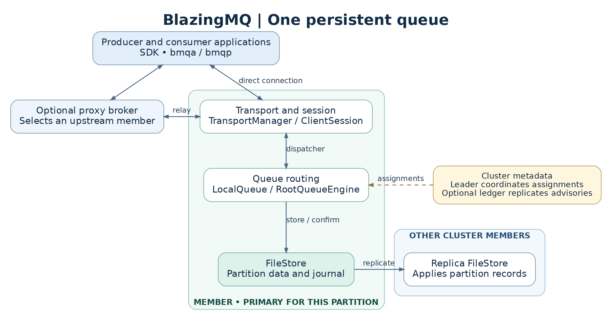

# BlazingMQ architecture

BlazingMQ is a C++ message broker and client SDK. Applications open a queue
by URI (`bmq://<domain>/<queue>`); the domain supplies the cluster and policies
for routing, storage, and consistency. Cluster members host queue partitions.
A broker can also act as a proxy for a cluster it does not belong to.



The diagram shows one persistent queue and its partition. Primary and replica
are **per-partition roles**, not fixed types of broker. A member can be primary
for one partition and replica for another. The **cluster leader** coordinates
cluster metadata and need not be the primary of the queue shown.
The proxy path is simplified: the selected upstream member may relay traffic
to the primary.

## Startup and configuration

1. [`bmqbrkr`](../src/applications/bmqbrkr/bmqbrkr.m.cpp) reads `bmqbrkrcfg.json`
   from the configuration directory given on the command line. It starts
   [`mqba::Application`](../src/groups/mqb/mqba/mqba_application.cpp), which
   initializes plugins, dispatchers, and transport, starts the domain manager
   and clusters, and then begins listening for connections.
2. [`ClusterCatalog`](../src/groups/mqb/mqbblp/mqbblp_clustercatalog.cpp) reads
   `clusters.json`. A cluster this broker belongs to is represented by
   `Cluster`; a cluster it accesses as a remote broker uses `ClusterProxy`.
   [`ConfigProvider`](../src/groups/mqb/mqba/mqba_configprovider.cpp) reads
   per-domain JSON from `domains/` under the same configuration directory.
   See the [local broker examples](../src/applications/bmqbrkr/etc).
3. [`TransportManager`](../src/groups/mqb/mqbnet/mqbnet_transportmanager.cpp)
   handles network connections and hands them to
   [`SessionNegotiator`](../src/groups/mqb/mqba/mqba_sessionnegotiator.cpp) for
   the protocol handshake and selection of the session type. The
   [`Dispatcher`](../src/groups/mqb/mqba/mqba_dispatcher.cpp) routes work to
   processors for sessions, queues, and clusters so each client's events are
   handled on its assigned dispatcher thread.

## Queue and message flow

1. **Open.** The C++ API in [`bmqa`](../src/groups/bmq/bmqa) delegates to
   [`bmqimp::BrokerSession`](../src/groups/bmq/bmqimp/bmqimp_brokersession.cpp).
   The client and broker exchange [`bmqp`](../src/groups/bmq/bmqp) control and
   message events. On the broker, [`ClientSession`](../src/groups/mqb/mqba/mqba_clientsession.cpp)
   handles SDK traffic. [`ClusterQueueHelper`](../src/groups/mqb/mqbblp/mqbblp_clusterqueuehelper.cpp)
   coordinates the queue assignment and routes opens to the relevant upstream
   node when the queue is not local.
2. **Publish and route.** At the primary, [`LocalQueue`](../src/groups/mqb/mqbblp/mqbblp_localqueue.cpp)
   handles `PUT` and writes accepted messages that have a delivery target to
   the queue's storage. [`RootQueueEngine`](../src/groups/mqb/mqbblp/mqbblp_rootqueueengine.cpp)
   applies the domain's routing rules, including priority, fan-out by app ID,
   and broadcast. A non-primary broker uses
   [`RemoteQueue`](../src/groups/mqb/mqbblp/mqbblp_remotequeue.cpp) and
   [`RelayQueueEngine`](../src/groups/mqb/mqbblp/mqbblp_relayqueueengine.cpp)
   to relay traffic rather than own the queue. A proxy selects an active
   upstream cluster member.
3. **Acknowledge and consume.** `ACK` is the response to a producer's `PUT`,
   not proof of consumer processing. For a stored message in a strongly
   consistent queue, a successful requested `ACK` waits for the configured
   storage replication receipt threshold. Consumers receive `PUSH` events and
   send `CONFIRM` for tracked deliveries. Storage records confirmations and can
   retire a message once none of its delivery references remain.

## Metadata, storage, and failover

- **Cluster metadata:** [`Elector`](../src/groups/mqb/mqbnet/mqbnet_elector.cpp)
  elects a cluster leader. [`ClusterOrchestrator`](../src/groups/mqb/mqbblp/mqbblp_clusterorchestrator.cpp)
  and the state managers coordinate queue assignments and partition primaries.
  When enabled, the [Cluster State Ledger](../src/groups/mqb/mqbc/mqbc_clusterstateledger.h)
  replicates metadata advisories; it is not the message store.
- **Partition data:** [`FileStore`](../src/groups/mqb/mqbs/mqbs_filestore.cpp)
  manages the data and journal files for a persistent partition. The primary
  sends storage records to member replicas. In-memory storage is a separate
  policy; the file replication shown does not apply to it.
- **Recovery:** [`Cluster`](../src/groups/mqb/mqbblp/mqbblp_cluster.cpp) selects
  legacy or FSM storage management from configuration. With the FSM workflow
  enabled, [`PartitionFSM`](../src/groups/mqb/mqbc/mqbc_partitionfsm.h) drives
  partition recovery in [`mqbc::StorageManager`](../src/groups/mqb/mqbc/mqbc_storagemanager.cpp).
  Queue reopening and upstream changes are handled by `ClusterQueueHelper`.

## Where to make changes

| Concern | Start here |
| --- | --- |
| SDK API, session implementation, wire protocol and channels | [`src/groups/bmq`](../src/groups/bmq) (`bmqa`, `bmqimp`, `bmqp`, `bmqio`) |
| Broker contracts, configuration schemas and statistics | [`src/groups/mqb`](../src/groups/mqb) (`mqbi`, `mqbcfg`, `mqbconfm`, `mqbstat`) |
| CLI and on-disk storage inspection | [`bmqtool`](../src/applications/bmqtool) and [`bmqstoragetool`](../src/applications/bmqstoragetool) |
| Optional Prometheus stats consumer | [`src/plugins/bmqprometheus`](../src/plugins/bmqprometheus) |
| End-to-end behavior (startup, queue modes, replication and recovery) | [`src/integration-tests`](../src/integration-tests) and its [test runner guide](../src/integration-tests/README.md) |

## Update the diagram

Edit the [Graphviz source](diagrams/architecture.dot), then regenerate the PNG
with Graphviz and DejaVu Sans installed. Run from the repository root:

```sh
dot -Tpng docs/diagrams/architecture.dot -o docs/diagrams/architecture.png
```
